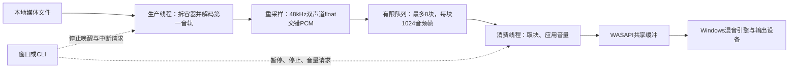

# S04：本地音频播放

S06当前入口（2026-11-14）：基础摄像头预览/可选麦克风MP4已实现，见[摄像头说明](CAMERA_CAPTURE.md)。本篇原有功能仍按自己的范围使用；S06复用不表示它新增所有摄像头控制、HDR或设备恢复。当前学习优先读本地六册，历史段落按日期理解。

先想弄清这个功能由哪些模块、库和函数配合完成，可以从[功能串讲的S04一节](FEATURES_S01_S04_WALKTHROUGH.md#s04)开始，再回来查本篇的使用和边界。

2026-11-13。基础功能已实现：Win32窗口和CLI播放本地文件的第一条音轨，支持暂停/继续、停止、0—100%音量和自然结束。核心使用FFmpeg C API和Windows WASAPI共享模式，不调用ffmpeg命令行。

自动验证与待人工验收见文末；这不是已完成的视频播放器。

## 先用起来

在VS2026打开根目录`MiniClipStudio.slnx`，将AudioCapture设为启动项目，选择Debug/x64或Release/x64，执行“生成→生成解决方案”。测试工程LifecycleTests独立保留。

**打开窗口**：右键AudioCapture→属性→配置属性→调试，清空“命令参数”（本机原来可能留有S03的`--export ...`），按Ctrl+F5。“播放音频…”选择自己的WAV、含音轨的MP4或其他支持文件；“暂停播放/继续播放”保留播放位置；“停止播放”丢弃待播内容并退出两个线程。音量下拉框有0/25/50/75/100%，窗口初始50%。播放与原有录音/探测在界面上互斥，避免初学阶段混合多个任务。

**CLI**：也可将“命令参数”设为：

```text
--play "C:\Projects\MiniClipStudio\Recording-example.wav" --volume 50
```

或在PowerShell调用已有程序（路径请替换成真实文件）：

```powershell
& 'C:\Projects\MiniClipStudio\AudioCapture\x64\Release\AudioCapture.exe' --play 'C:\Projects\MiniClipStudio\1pro.mp4' --volume 50
```

CLI中P暂停/继续，Q或Ctrl+C停止；没有控制台输入的重定向运行仍能自然结束。退出码0=自然完成，3=明确停止，1=失败，2=命令用法错误。CLI默认100%；音量参数只能是0—100的整数。设备固定选择Windows当前默认的eConsole播放端点（通常是扬声器/耳机）；不是麦克风下拉框。

## 声音怎样从文件到耳机



1. `wmain`有`--play`参数时调用`RunPlaybackCommand`；无参数创建窗口，点击播放经`WndProc→StartPlayback`选择文件。两者最终调用同一个`AudioPlayer::Start`。
2. Start创建消费线程Run；Run在自己的线程初始化COM、打开WASAPI，随后创建生产线程Produce。
3. Produce调用`DecodeAudioFile`。`avformat_open_input/find_stream_info`读取文件和轨道，`av_read_frame`取包，只将第一音轨的包送到`avcodec_send_packet/receive_frame`。文件含视频时不解码视频。
4. 从**实际AVFrame**读取采样率、声道布局、样本格式；`swr_alloc_set_opts2/init/convert`把S16、S32、FLTP等输入转换为固定播放格式。FLTP的左右声道分开存，必须用`extended_data`，不能把AVPacket强转成PCM。
5. 转换结果拼成PcmBlock。队列满时用条件变量释放锁并等待；消费者取出一块后通知生产者继续。暂停也阻止继续入队。不会把整首歌解码到一个无限增长的vector。
6. Run通过`GetCurrentPadding`取得设备尚未消费的音频帧数，剩余空间=`GetBufferSize-padding`。仅向空闲部分写入；`GetBuffer/ReleaseBuffer`必须成对。样本乘本程序音量，非有限值置0，过载钳到[-1,1]。
7. `IAudioClient::Start`启动设备；事件通知/最多10ms等待后继续观察缓冲。等待不是按文件时长sleep，也不把CPU解码速度当播放速度。
8. EOF后先排空解码器、再排空重采样器、交付最后不足1024帧的块；生产者完成后，消费者继续等队列和设备padding都为0，才报告Completed。

一个“音频帧”是同一时刻各声道样本的集合。48kHz双声道float：每秒48000音频帧，每帧2×4=8字节。它与视频AVFrame不是同一尺寸概念。1024帧约21.33ms，8块约170.67ms；这里只是应用队列容量，不是端到端延迟保证。

## 每个文件与资源所有权

| 文件 | 职责和主要入口 |
|---|---|
| `src/media/audio/AudioDecode.h/.cpp` | PcmBlock、AudioDecodeResult、PlaybackCancelled；同步DecodeAudioFile，拥有本次文件、解码器、帧/包和重采样器，回调交出普通数据块 |
| `src/platform/windows/output/WasapiOutput.h/.cpp` | 只在消费线程使用。Open/Padding/Write/Start/Pause/Wait；ComPtr拥有COM接口，析构先停设备/释放接口和事件，再CoUninitialize |
| `src/playback/AudioPlayer.h/.cpp` | Start/SetPaused/Stop/SetVolume/Snapshot/TryJoin/Shutdown；拥有消费线程，Run局部拥有生产线程，mutex保护队列与整份状态 |
| `apps/cli/PlaybackCommands.h/.cpp` | 参数与按键解析、Ctrl+C注册/注销、状态打印；AudioPlayer局部对象负责异常时停止并join |
| `apps/cli/AudioCommands.cpp` | 只新增`--play`分发，不复制播放算法 |
| `apps/desktop/main.cpp` | 新增选文件、播放/暂停/停止/音量控件、50ms状态轮询、关窗先停止后销毁 |
| `tests/integration/PlaybackTests.h/.cpp` | 测试专用PCM输出和真实设备静音验证；不加入产品EXE |
| `tests/verify_playback.py` | 生成已知信号，用真实C API链路核对帧数/频率/声道、错误与可选设备验证 |

输入资源复用`InputResources`、`Frame/Packet`自定义删除器和`Check`。生产者的资源由生产者释放，消费者的COM/设备由消费者释放。回调按值交付PCM块，不将帧内部地址留给另一个线程。

队列上限8×8192=65536字节有效样本存储，另有块结构/容器开销、生产/消费当前块、解码器/输入缓冲、转换临时区和Windows缓冲。转换暂存最多500000×2×4=4000000字节；单帧输入最多65536样本。**有界PCM队列不等于整个进程内存固定64KiB**。

## 暂停、停止和结束的差别

| 操作/事件 | 行为 |
|---|---|
| 暂停请求 | GUI只写请求并通知；消费线程调用IAudioClient::Stop，保留设备会话、padding、当前块与队列；不重新从头解码 |
| 继续请求 | 唤醒等待，消费线程重新Start，接着使用保留数据 |
| Stop | 原子停止标志+notify_all，解码中断回调与队列等待都观察；不再排空剩余内容 |
| 自然结束 | 解码/转换尾部、应用队列和设备缓冲全部消费完，才Completed |
| 设备/解码失败 | Failed并保留错误；消费端异常也停止并唤醒生产端，再真实join |
| 关窗 | 请求Stop，继续消息循环，TryJoin零等待确认线程真正退出后才DestroyWindow |

暂停通常保留会话以便无损继续，**不是释放所有设备对象**。共享模式允许其他应用使用输出；停止/自然结束/失败/关闭后释放本会话。路线原“暂停/关闭释放设备”已明确为以上可验收语义。

`atomic<bool>`适合独立停止标志；队列需要“检查容量+放入/取出+状态更新”的整体一致性，所以用mutex。`condition_variable::wait(lock,predicate)`在等待时释放锁，被唤醒后重新加锁并再次检查，避免假唤醒和丢通知。队列满时Stop必须唤醒生产者；否则消费者不再取数据，生产者可能永远等空位。

`joinable()`只表示线程仍须回收，不表示仍运行。TryJoin用Windows零等待检查，确认已退出才join。Shutdown是异常/析构兜底，会真实等待，不detach、不超时后假装已退出。GUI只常规轮询TryJoin。设备API调用不持有共享mutex，减少界面因驱动操作等待的机会。

## 时钟、状态和性能意识

`decodedFrames`表示已交入应用队列的累计帧数；`submittedFrames`表示累计交给Windows缓冲的帧数；`playedFrames=submitted-padding`只是**应用格式下的消费估算**。它不含精确硬件呈现延迟，也不等价于未来音画同步需要的完整时钟。S05再研究IAudioClock/时间戳、偏移、同步与seek。

同时记录队列峰值、实际设备缓冲容量和饥饿区间计数。饥饿计数指运行中发现设备、当前块、队列均空且生产者未结束的连续区间；0不证明永无可闻断音。100ms只是请求值，实际容量从API读取。设备10秒没有消费进展会报错；这不是可强制杀死任意驱动/文件I/O的硬实时期限。

现阶段先建立正确性与观测点：固定块、有界队列、事件等待、帧/包复用。暂未做无锁队列、GPU、独占低延迟、MMCSS调度或大规模线程优化。后续先测CPU、峰值内存、长时稳定性、操作响应和听感，再按数据选择改动。

## 兼容范围与限制

当前支持本地文件、首条音轨、固定格式的mono/stereo、8—192kHz，以及本机FFmpeg可解码的音频；源格式变化/多声道/超出分配限制明确失败。输出统一48kHz/float32/stereo，Windows共享引擎按需要适配物理设备格式（使用AUTOCONVERTPCM和SRC_DEFAULT_QUALITY）。

不包含网络播放、输出设备选择/热切换、seek、倍速、播放列表、视频画面、音画同步、时间戳空洞修复、多轨混音或录音监听。音轨按顺序播放解码样本，不使用视频的起始偏移调度。设备拔出/默认设备变化可能失败，需要停止后重新播放；未实现自动恢复。音量变化对已写入设备的缓冲不会追溯生效，有缓冲时延。

## 自动验证与人工验收

```powershell
python -X utf8 tests/verify_playback.py --exe AudioCapture/x64/Debug/AudioCapture.exe --lifecycle build/lifecycle/Debug/LifecycleTests.exe --with-device
```

不传`--with-device`只检查解码/转换及命令用法，不能据此声称WASAPI成功。设备测试在真实默认设备静音播放，不替换假时钟；检查暂停180ms期间计数冻结、继续推进、尾部全部消费、队列不超过8、队列满时暂停停止、重复启动和错误后回收。

已知信号覆盖8/16/24位PCM、float32、不同采样率、单双声道、非整块尾部、中文空格路径、AAC/planar和首轨选择；核对实际输出float的帧数与440/880Hz频率，检查源文件哈希不变。还执行原S00—S03回归。具体路径和测量见[本轮记录](worklogs/2026-11-13-s04-audio-playback.md)。

**待人工验收**：在VS打开窗口，用真实WAV和S03 MP4分别试听；核对音调/速度、左右声道、暂停/继续、0/50/100%音量、播放中关窗、长素材、拔出设备及默认设备切换。本轮窗口自动化工具启动失败，未将GUI操作记为通过。自动计数不代替人的听感验收。

## 官方参考与理解检查

- [Microsoft：IAudioClient::Initialize](https://learn.microsoft.com/en-us/windows/win32/api/audioclient/nf-audioclient-iaudioclient-initialize)：共享模式、缓冲与初始化条件。
- [Microsoft：Rendering a Stream](https://learn.microsoft.com/en-us/windows/win32/coreaudio/rendering-a-stream)：padding、空闲容量及GetBuffer/ReleaseBuffer。
- FFmpeg具体签名已以本机SDK头文件及Debug/Release实际编译核实。

1. 为什么“已经解码96000帧”不能直接报告“已经播放2秒”？
2. 队列已经满了，此时停止消费者，为什么还必须唤醒生产者？
3. 为什么暂停保留缓冲，而自然结束需要把缓冲播完？

答案与更细的逐函数解释见本地学习文档S04章节；用户是否掌握尚待答题，不因程序测试通过而标记学习完成。
