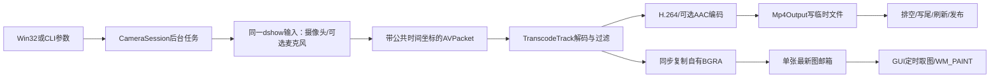

# S06：摄像头预览与带麦克风的MP4录制

2026-11-14。当前实现沿用VS2026/Win32、FFmpeg C API和CPU编码，不引入Qt或CMake。摄像头窗口与文件播放器分开：摄像头不断产生新内容，没有文件总时长，也没有S05的seek或播放暂停语义。

## 在VS中使用

1. 打开根目录MiniClipStudio.slnx，将AudioCapture设为启动项目，选择Debug/x64或Release/x64，生成解决方案。确认生成成功，清空“项目属性→调试→命令参数”，Ctrl+F5运行。
2. 主窗点击“拍摄 / 区域录屏…”并选择摄像头来源。窗口在后台枚举设备，选摄像头后在后台读取模式；模式栏显示分辨率、驱动帧率、100ns帧间隔、像素/压缩格式及驱动公布的帧率范围。
3. 选一个受支持模式。点击“只预览”不保存文件、也不监听麦克风。停止预览后才能开始另一场录制；当前不提供预览中无缝切换录制。
4. 录制前选择麦克风，或选择“无声录制”；设置0—10秒倒计时和1—120整数输出fps，点击“录制MP4…”，选一个不存在的小写`.mp4`新路径。
5. 录制时同样显示画面；“停止并保存”结束读取，再排空解码器、过滤器和编码器，写文件尾、刷新、关闭并发布。看到“MP4已完整保存”后再打开文件。关窗也先走停止保存，等待真实线程退出才销毁。

模式中的fps是驱动的采集规格；输出fps是成片的固定帧率，两者不同。驱动自动曝光、负载和设备缓冲仍会影响实际交付节奏；CFR编码可能复制/丢弃画面，不把“模式30fps”解释为每秒恰好收到30张不同图。当前选择驱动逐项列出的默认帧间隔，不枚举尺寸/帧率范围内所有组合。

## CLI与诊断

在项目根PowerShell使用当前构建路径；以下是使用示例，不是每台机器都存在摄像头0、模式4和麦克风0：

```powershell
& '.\AudioCapture\x64\Debug\AudioCapture.exe' --camera
& '.\AudioCapture\x64\Debug\AudioCapture.exe' --cameras
& '.\AudioCapture\x64\Debug\AudioCapture.exe' --camera-modes 0
& '.\AudioCapture\x64\Debug\AudioCapture.exe' --camera-options 0
& '.\AudioCapture\x64\Debug\AudioCapture.exe' --devices
& '.\AudioCapture\x64\Debug\AudioCapture.exe' --camera-record 0 4 '.\workspace\新无声拍摄.mp4' --seconds 4 --fps 30
& '.\AudioCapture\x64\Debug\AudioCapture.exe' --camera-record 0 4 '.\workspace\新有声拍摄.mp4' --mic 0 --seconds 4 --fps 30 --countdown 3
```

`--camera`打开同一窗口。`--camera-options`调用FFmpeg的list_options，用其日志交叉核对DirectShow能力。`--verbose`可加到录制命令显示更详细库日志。设备序号只是本次列表中的位置；会话复制唯一设备名，不把中文显示名当稳定ID。不支持包含冒号/引号等解析字符的特殊设备标识时明确失败。

不指定seconds则持续到Ctrl+C；Ctrl+C在S06表示停止并保存，成功保存仍返回0。预开始就停、没有生成成品返回3，失败返回1，命令用法不匹配返回2。GUI关闭同样要等待，不使用强杀或detach。

`--seconds`对真实设备限制采集主循环的墙钟时间，不包括倒计时/打开/探测；开始时可能已有少量缓冲，最终媒体时长可能略长。它不是S03的精确裁剪接口。模拟文件中seconds才作为离线媒体区间限制。

```powershell
# 明确的测试入口，不表示在采集真实摄像头。
& '.\AudioCapture\x64\Debug\AudioCapture.exe' --camera-simulate '已知输入.nut' '.\workspace\新模拟输出.mp4' --fps 25
```

## 文件和函数分工

| 文件 | 在S06中做什么 |
|---|---|
| src/platform/windows/capture/CameraCatalog.h/.cpp | CameraDevice/CameraMode、ListCameraDevices与ListCameraModes；COM枚举视频类别及IAMStreamConfig能力，复制普通值后释放接口 |
| src/capture/camera/CameraCapture.h/.cpp | CameraCaptureOptions/Result、RunCameraCapture；打开、选轨、有限预取公共原点、预览/编码分发、停止收尾 |
| src/capture/session/CameraSession.h/.cpp | Launch/QueryDevices/QueryModes/Start/Stop/TryJoin/Snapshot/TakePicture；拥有后台线程与单张最新图邮箱 |
| apps/desktop/CameraWindow.h/.cpp | OpenCameraWindow/Procedure/Poll/StartCapture；设备与模式选择、倒计时、文件选择、画面和延后关闭 |
| apps/cli/CameraCommands.h/.cpp | RunCameraCommand；参数、Ctrl+C、结构化结果及诊断，不重复实现媒体引擎 |
| apps/desktop/main.cpp、apps/cli/AudioCommands.cpp | 主窗新增按钮、窗口互斥/关闭与消息路由；分发S06命令 |
| src/media/encode/TranscodeTrack.h/.cpp | 复用解码→滤镜→H.264/AAC；新增可选同步视频观察者供S06复制预览，S03默认空回调 |
| src/media/mux/Mp4Output.h/.cpp | 复用已有独占临时文件、MP4写头/包/尾、刷新和不覆盖发布 |
| src/platform/windows/output/VideoSurface.h/.cpp | 复用已有BGRA等比绘制；S06由GUI取最新图，没有套用S05播放时钟 |
| tests/integration/CameraTests.h/.cpp、tests/verify_camera.py | 已知像素、真实解码/编码、偏移、停止、异常、文件保护与可选真实设备检查 |

## 从点击到保存，完整讲一遍

1. `wmain`进入Win32消息循环，主窗按钮调用OpenCameraWindow。窗口拥有WindowData，里面拥有CameraSession。owner暂时禁用，消息循环仍运行。
2. QueryDevices/QueryModes经Launch创建后台线程，读取设备/模式，短锁保存快照。GUI每50ms调用Poll；TryJoin确认系统线程真正退出后join，再把返回的vector填入组合框。不能拿旧快照判断刚结束的任务，因此join后重新读取终态。
3. StartCapture复制设备唯一名、CameraMode、可选麦克风、输出路径、倒计时、输出fps；CameraSession::Start将整份选项复制进线程lambda，局部控件字符串结束也不会悬空。
4. RunCameraCapture验证参数与目标，倒计时每50ms检查停止。随后在同一dshow输入中指定`video=设备[:audio=设备]`，设置实际模式、有限输入缓冲与非阻塞读取，登记中断回调。
5. 视频关闭设备自带时间戳选项，改用DirectShow参考时钟；麦克风也在同一输入图。这样提供共同采集坐标，但不宣称所有设备无漂移。FFmpeg官方说明同一输入打开音视频设备有利于同步：[DirectShow选项](https://ffmpeg.org/ffmpeg-devices.html#dshow)。
6. 打开并探测实际流，找首条非封面视频与所需音轨，检查真实尺寸。有限预取等所需轨道各出现一包，取最早PTS作为共同origin。最多512包/32MiB、10秒等待，缺轨或无时间戳明确失败。
7. 录制创建Mp4Output与每轨TranscodeTrack，复制编码参数后写头。包按stream_index交给对应轨道，解码真实Frame；声音转换/分块交AAC，画面转换为目标YUV420P并按目标fps交libx264，结果交错封装。
8. 视频观察者同步借用解码Frame，将其data/linesize交sws_scale，复制成自有BGRA vector。CameraSession以shared_ptr<const PreviewPicture>保存一张最新图，旧图未取走就替换；GUI每50ms取图并在WM_PAINT调用DrawPreviewPicture。源Frame随后unref不影响GUI图像。
9. “只预览”不创建输出/编码器，只解码视频并转换BGRA。录制时麦克风不实时送扬声器，避免反馈回声；成品仍有AAC音轨。
10. 停止标志只结束输入，不传给编码轨道当“撤销”标志。已收到的包和延迟帧仍排空；随后轨道Finish→输出Finish→Publish。只有有效视频、所需声音和收尾都成功才报告saved；设备/解码/磁盘故障清理自有草稿，不伪装成正常停止。
11. CameraSession记录最终值，线程返回。GUI仍等真实TryJoin，才能启动下一任务或销毁窗口；终态标志和系统线程退出是两个时刻。驱动若不响应，不能超时后假装回收。



## 数据结构、资源和性能取舍

设备/模式是vector中的自有string和整数；工作线程复制options，FFmpeg上下文/编解码器/过滤器/句柄只归当前调用拥有。InputResources、Frame/Packet、Mp4Output和原有轨道的RAII覆盖失败；COM接口用ComPtr，GetStreamCaps的AM_MEDIA_TYPE需释放内部格式块、pUnk引用及外层内存。能力接口的分配约定见[微软GetStreamCaps说明](https://learn.microsoft.com/en-us/windows/win32/api/strmif/nf-strmif-iamstreamconfig-getstreamcaps)。

本阶段用一条采集/编码worker避免跨线程共享容器，先降低所有权复杂度。后台编码慢仍会导致驱动缓冲丢包；16MiB输入缓冲和单图邮箱限制部分积压，不代表整个进程只占这些内存，也不保证零丢帧。邮箱替换只影响显示，不删除已交编码的数据。尚未建立CPU/GPU新优化结论。

默认沿用S03的libx264 CRF23/medium/zerolatency、AAC 48kHz双声道128k、CPU单线程配置；采集原始mono/planar会先转换，不能直接写AAC或把AVPacket当PCM。后续依据真实录制CPU、交付间隔、源帧数、成片帧数、队列/内存和停止延迟，单独评估preset、线程或硬件编码。

## 已调试的问题

- 摄像头协商失败：驱动帧间隔333333个100ns；直接传10000000/333333经FFmpeg帧率解析约分，再向下还原时可能出界。CameraRate选择整数间隔中点的可表示有理数并校验往返结果；真实短录验证修正有效。解析行为参考[FFmpeg parseutils源码](https://github.com/FFmpeg/FFmpeg/blob/master/libavutil/parseutils.c)，不能只看浮点打印出的“30.000”。
- 摄像头不应依赖机器同时有麦克风：FFmpeg联合清单可能因音频类别不可枚举而失败。S06改为直接查询DirectShow视频类别，麦克风单独查询，失败作为警告，仍允许无声摄像头。
- 后台任务恰在快照后结束：Poll先取的快照可能仍是Working，TryJoin后必须重新取最终值，否则会漏填设备列表。
- 首次编译缺Windows声明、一次测试误把PCM输出当后缀前缀，均已修正；失败运行不计为通过证据。

## 验证方式和边界

```powershell
python tests/verify_camera.py --exe '.\AudioCapture\x64\Debug\AudioCapture.exe' --lifecycle '.\build\lifecycle\Debug\LifecycleTests.exe' --with-camera --mode 4
```

模式序号按本机重新选择。脚本默认可做文件数值与枚举验证；加with-camera才真实拍摄，并在workspace创建报告与私有样本，不上传。回归结果和构建日志见本次worklog；本机已实际完成摄像头/麦克风短录，不能据此宣称长录或端到端物理音画同步通过。

仍待人工：可见GUI操作、真实观感/听感、缩放/最小化/关闭、长时录制、不同驱动/分数帧率、隐私权限拒绝、设备占用/拔出恢复。窗口验收工具初始化报os error 3，未实际操作可见窗口。HDR/旋转/SAR校正、设备热恢复、GPU、录制暂停、无缝预览转录制、麦克风监听仍未实现；失败只报告并清理，不自动重连。

## 三道理解题

1. 为什么“停止录制”不能直接复用S03“取消导出”？因为前者要保留已录内容并排空，后者撤销输出；同一个atomic并不决定业务语义。
2. 为什么新图覆盖旧预览图不代表成片丢帧？图邮箱在显示支路，编码链已处理自己的帧；但上游驱动过载仍可能真丢包，两者应分别测量。
3. 为什么不能把摄像头和麦克风各自第一个PTS设成0？会抹掉启动偏移；同一采集时基减共同origin才保留相对时间，长期漂移仍需额外验证。

## 区域录屏入口及绘图更新（2026-11-14）

主按钮现为“拍摄 / 区域录屏…”，来源可选择手动区域无声录制；旧摄像头/麦克风流程保留，选择摄像头时按本篇操作。区域模式详见[新说明](SCREEN_RECORDING.md)，不使用摄像头模式列表，也不把麦克风音轨静默当已支持。两类预览共用内存双缓冲，避免中间清屏。
