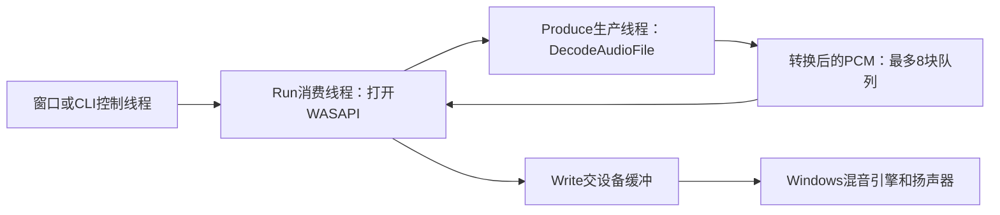

# S01到S04：每个功能怎样由模块、库和函数配合完成

更新：2026-11-14。本篇按当前实现解释调用关系。S01—S04都已有基础功能，具体兼容范围和验证状态仍见各专项文档；S05基础预览/同步/seek已实现，续篇见[视频预览](VIDEO_PREVIEW.md)。

阅读时先分清三个名称。**FFmpeg库**是已经做好的工具，例如libavformat负责读写媒体容器；**项目模块**是我们组织这些工具完成目标的代码，例如MediaProbe负责探测；**函数**是一次具体操作，例如ProbeMediaFile接收文件路径并返回信息。一个头文件声明能调用什么，相应cpp给出怎么做，它们不必各自生成一个独立库。

S编号表示开发与学习顺序。每条命令都有自己的入口：S03直接从ExportMp4打开源文件、处理轨道，不必先运行一次S01和S02命令。它们共享FFmpeg基础工具及已经学过的概念。

## 先找到自己要看的功能

| 阶段 | 用户操作与结果 | 项目里负责组织的模块 | 主要现成库/系统接口 |
|---|---|---|---|
| S01 媒体信息探测 | 窗口查看信息，或`--probe INPUT`，得到文件和各轨参数报告 | MediaProbe、RecordingController、桌面/CLI入口 | libavformat读取，libavcodec解释编码名称，libavutil解释格式/布局/时间 |
| S02 视频解码与首帧导出 | `--video-frame INPUT OUTPUT.png`，得到首帧PNG和整段解码帧数 | VideoFrameExport及其临时图片对象 | libavformat读包，libavcodec解码/PNG编码，libswscale转换像素 |
| S03 转码与MP4导出 | `--export INPUT OUTPUT.mp4 ...`，得到H.264和可选AAC成品 | Transcode、TranscodeTrack、Mp4Output、TranscodeCommands | libavformat、libavcodec、libavfilter，以及Windows文件IO |
| S04 本地音频播放 | 窗口播放，或`--play INPUT`，把声音送往扬声器 | AudioPlayer、AudioDecode、WasapiOutput、播放入口 | libavformat、libavcodec、libswresample、Windows WASAPI/COM |

它们都使用[FfmpegSupport](../src/media/ffmpeg/FfmpegSupport.h)处理路径、错误和资源：`Utf8`转换路径编码，`Check`解释负错误码，`NewFrame/NewPacket`创建由智能指针管理的帧/包，`InputResources`在离开作用域时关闭输入。这里的Frame/Packet对象及其内容有不同寿命，不能随意用delete代替库的释放函数。

## S01：查看一个文件里面装了什么

S01接收文件路径，返回`MediaInfo`和文字报告。它读取容器、轨道和编码参数；本项目不在这一入口逐包完整解码整段内容，因此信息可读不代表整段媒体没有损坏。

### 从哪里进入

窗口中点击“查看媒体信息…”时，Windows把点击消息交给[main.cpp](../apps/desktop/main.cpp)的`WndProc`。它调用`StartProbe`选文件，再由`StartJob`把任务交给`RecordingController::Start`。控制器创建后台线程，在`TaskKind::ProbeMedia`分支调用`ProbeMediaFile`，窗口仍继续处理消息。

CLI的路径更短：`wmain → RunAudioCommands → ProbeMediaFile → FormatMediaInfo`。这里直接在CLI线程处理，不再为这个同步命令创建控制器任务。

### 哪些文件和函数在配合

| 文件/函数 | 在S01中实际负责什么 |
|---|---|
| [MediaProbe.h](../src/media/probe/MediaProbe.h)里的MediaInfo/MediaStreamInfo | 保存复制出来的文件信息单、各轨信息单，未知字段用optional等形式保留 |
| [MediaProbe.cpp](../src/media/probe/MediaProbe.cpp)的ProbeMediaFile | 检查路径，打开/探测文件，再复制容器和所有轨道参数 |
| ReadStreamInformation | 从一条AVStream和codecpar中读取类型、编码、时长、音频/视频专有参数 |
| ReadDuration/ReadBitRate/CopyRational | 保留时间单位和未知值，不把未提供信息误填成0 |
| InterruptProbe/CheckProbeState | 在FFmpeg读取及阶段检查点观察取消/期限，并区分停止、超时和读取失败 |
| FormatMediaInfo及KnownText/Number/Rate/Duration/Rational | 将信息单转成有单位、有中文说明、能显示“未知”的UTF-8报告 |
| [RecordingController.cpp](../src/application/RecordingController.cpp)的TryJoin/ClearFinished | 确认后台线程真正退出，再让窗口读结果并释放任务单 |

### ProbeMediaFile里面怎样一步步完成

1. 先检查取消和本地普通文件，再把路径转成绝对路径及UTF-8。这里处理的是文字编码，尚未解码音视频。
2. 用`avformat_alloc_context`准备输入会话，设置中断回调和file协议范围。
3. 用libavformat的`avformat_open_input`打开文件，`avformat_find_stream_info`补充轨道信息。`AVFormatContext`保存容器级信息，里面的`streams`指向各条轨道。
4. 遍历所有轨道调用`ReadStreamInformation`。libavcodec的`avcodec_get_name/avcodec_descriptor_get`解释编码名称；libavutil的布局、样本/像素名称和有理数工具让参数可读。
5. 把需要的字符串、数字复制进`MediaInfo`。函数返回时关闭FFmpeg输入，调用者仍能读取自己的信息单。
6. GUI定时器的`Poll`先调用`TryJoin`，确认后台退出后才用`FormatMediaInfo`生成报告，再通过`Status`显示。CLI直接打印报告。

继续阅读：[S01使用与边界](MEDIA_PROBE.md)。

## S02：从编码视频里还原画面，并保存第一张

S02从首条非封面视频轨解码画面，只把第一张编码成PNG；后面仍顺序解完整段并统计帧数。控制台的`decoded_frames`表示实际解出了多少画面，不表示保存了多少PNG。

### 从哪里进入

目前使用CLI：`wmain → RunAudioCommands → ExportFirstVideoFrame`。没有S02窗口按钮。入口在[AudioCommands.cpp](../apps/cli/AudioCommands.cpp)，具体处理在[VideoFrameExport.cpp](../src/media/video/VideoFrameExport.cpp)。

### 哪些模块、库和函数在配合

| 环节 | 项目函数/对象 | 使用的库与关键API |
|---|---|---|
| 打开视频、选择轨道、读包 | ExportFirstVideoFrame | libavformat：avformat_open_input、avformat_find_stream_info、av_read_frame |
| 准备实际解码器 | ExportFirstVideoFrame | libavcodec：avcodec_find_decoder、avcodec_alloc_context3、avcodec_parameters_to_context、avcodec_open2 |
| 不断推进包到画面 | 局部send/receive | libavcodec：avcodec_send_packet/avcodec_receive_frame |
| 检查实际画面是否在支持范围 | ValidatePicture | 核对像素格式、尺寸、颜色和解码错误，不凭扩展名猜格式 |
| 把首帧转换为RGB24 | ConvertToRgb、ColorMatrix | libswscale的上下文、颜色设置和sws_scale；按源data/linesize读画面 |
| 把RGB像素压成真正PNG | EncodePng | libavcodec的PNG编码器：send_frame/receive_packet |
| 保存草稿并交付成品 | PendingPng::Write/Publish及析构 | Windows CreateFileW/WriteFile/FlushFileBuffers/MoveFileExW和失败清理 |

PNG也是需要编码的图像格式。RGB24只说明像素如何存放；把这段原始像素直接写成`.png`扩展名，并不会得到PNG文件。

### 画面经过哪些处理

1. 入口检查取消和输入/输出路径，打开媒体，找第一条不是封面图片的视频轨。其他音轨不送入视频解码器。
2. 依据该轨`codec_id`创建解码器，把流参数复制进去并打开。H.264等是编码规则，YUV420P等是解码后像素的存放规则，两者对应不同层次。
3. `av_read_frame`拿到包后交给局部`send`，后者内部调用`avcodec_send_packet`。这个FFmpeg调用若返回EAGAIN，就先`receive`取走已做好的结果，再重送原包；一个包可能产生多帧，也可能暂时没有帧。
4. `receive`拿到实际AVFrame，先调用`ValidatePicture`校验。当`decodedFrames`还为0时，记录首帧尺寸/时间并调用`EncodePng`；其中`ConvertToRgb`借助swscale变成RGB24，再由PNG编码器产生图片包。这些处理成功后才增加`decodedFrames`，因此首帧判断发生在计数之前。
5. 图片包写入`PendingPng`拥有的临时文件，源帧用完解除引用。后续视频帧继续解码和校验，但不再保存图片。
6. 输入EOF后向解码器送空包，取完延迟画面；完整处理成功后才`Publish`。中途失败或取消就清理自己的草稿，保留原片和已有目标。

图中首帧与后续帧的两条分支，都由同一个CLI线程按解码顺序处理。

当前范围是专项文档列出的8位SDR格式，没有旋转/SAR校正和HDR色调映射，也没有显示/按时播放视频。继续阅读：[S02使用与边界](VIDEO_FRAME_EXPORT.md)。

## S03：把已有素材加工成新的MP4

S03生成H.264画面和可选AAC声音，可以设置尺寸、固定整数帧率和片段范围。它由多个本地模块合作完成：一个模块安排任务，每条轨道各自处理，最后由输出模块封装和交付文件。

下面会遇到时间戳：PTS标记内容应在什么时候呈现，DTS标记按什么时间顺序解码，time_base说明一个刻度值多少秒。CFR就是固定帧率，例如输出每秒固定30张画面；这些字段决定如何安排内容的时间，不能把它们当作文件字节位置。

### 从哪里进入

目前使用CLI：`wmain → RunAudioCommands → RunTranscodeCommand → ExportMp4`。[TranscodeCommands.cpp](../apps/cli/TranscodeCommands.cpp)把参数填进`TranscodeOptions`，注册Ctrl+C处理器，再调用导出入口。`ExportMp4`同步完成工作，进度回调也在同一调用线程执行；FFmpeg内部可以使用配置的工作线程。

### 三个核心模块如何分工

| 模块 | 主要函数 | 它给S03完成哪件事 |
|---|---|---|
| [Transcode.cpp](../src/export/Transcode.cpp) | ExportMp4、ValidateOptions、InterruptExport、CheckCancel | 打开输入、选轨、确定共同时间起点、分发包、组织收尾和发布 |
| [TranscodeTrack.cpp](../src/media/encode/TranscodeTrack.cpp) | 构造函数、PushPacket、ReceiveDecoded、ProcessDecoded、OpenFilters、ReceiveFiltered、SendEncoded、ReceiveEncoded、Finish | 为一条视频/音频轨创建编解码器，把包还原成帧、加工帧、重新编码，再交出编码包 |
| [Mp4Output.cpp](../src/media/mux/Mp4Output.cpp) | WriteHeader、WritePacket、Write、Seek、Finish、Publish、Cleanup | 掌管临时文件和自定义IO，写入MP4结构、检查收尾、正式改名交付 |

`ProcessCpuSeconds`读取进程CPU累计时间，`ScopedSeconds`记录部分API调用的墙钟耗时，最后汇总指标。它们帮助观察成本，不参与改变画面或声音内容，也不等于CPU采样分析器。

### FFmpeg库在S03里各做哪一步

- **libavformat**打开输入、读不同轨道的包，建立输出MP4流，并用`avformat_write_header/av_interleaved_write_frame/av_write_trailer`组织文件结构。
- **libavcodec**根据源codec_id选择解码器，再找到libx264和AAC编码实现，创建目标编码器。`avcodec_send_packet/avcodec_receive_frame`还原帧，`avcodec_send_frame/avcodec_receive_packet`生成新包；编码器实现必须在本机SDK中可用。
- **libavfilter**在帧之间接处理步骤。视频链含trim、setpts、fps、scale、setsar和format；声音链含atrim、asetpts、aresample、aformat及asetnsamples等步骤。`avfilter_graph_parse_ptr`和`avfilter_graph_config`连接并检查图，`av_buffersrc_add_frame_flags`送入帧，`av_buffersink_get_frame`取结果。这些名字是图里的处理节点，配方由C API解析，不启动FFmpeg命令行程序。
- **libavutil**提供帧/声道布局、时间戳换算和错误工具。音频重采样、画面缩放由本轮配置的过滤器图调用相应库实现；S03没有在ExportMp4里手写S04那套swr循环。
- **Windows文件IO**由Mp4Output使用CREATE_NEW创建专属临时文件。FFmpeg写出的字节经AVIO回调交给WriteFile，Seek回调允许封装器回头定位；Finish显式刷新并关闭，Publish才交付目标名。

### 一包数据怎样变成新文件里的内容

1. `ValidateOptions`检查路径、目标不存在、片段时间和输出规格。ExportMp4用libavformat打开源文件，选择首条非封面视频及可选首音轨。
2. 总调度确定同一个源时间起点，加上用户裁剪起点，传给各个TranscodeTrack。两轨共同减这个起点，保留原本的相对延迟；各减各的第一PTS会抹掉声音偏移。
3. 每个TranscodeTrack建立源解码器和目标编码器，并在Mp4Output的上下文中创建自己的输出轨道。输出准备好后，WriteHeader写MP4头。
4. ExportMp4不断`av_read_frame`。匹配哪个SourceIndex，就把包交给哪个`PushPacket`。PushPacket发送包并通过`ReceiveDecoded`取帧。
5. `ProcessDecoded`检查帧的时间和真实格式；第一帧调用`OpenFilters`建立图，之后送入图的入口buffersrc。视频做裁剪、时间归一、CFR与缩放，音频按共同时间轴做裁剪和规格转换。
6. `ReceiveFiltered`从图的出口buffersink取处理结果，调整到编码器时间单位，再交给`SendEncoded`。SendEncoded和ReceiveEncoded推进编码器，拿到目标H.264/AAC包。
7. `ReceiveEncoded`将包时间戳换成输出轨道单位，检查DTS顺序，调用`Mp4Output::WritePacket`装进MP4。编码和封装是两个动作：前者决定数据表示，后者决定怎样放进文件。
8. 输入结束后各轨`Finish`依次排空解码器、过滤器和编码器。输出`Finish`写尾、刷新并关闭，最后再检查取消，成功才`Publish`。取消/失败保留错误并清理自有临时文件，不覆盖已有成品。

当前采用受限的8位SDR、mono/stereo等范围；不做旋转/HDR处理，短片段仍从头顺序读取源文件。完整选项与限制见[S03说明](TRANSCODING.md)，指标解释见[性能流程](PERFORMANCE_WORKFLOW.md)。

## S04：把文件里的声音按设备速度播放

S04将文件的第一条音轨还原为PCM，交给Windows默认输出设备。播放不需要生成新媒体文件，速度由音频设备的消费节奏决定；不能把CPU尽快解码完当作已经播放完。

### 从哪里进入

窗口路径：`WndProc → StartPlayback → AudioPlayer::Start`。文件选择完成后就启动后台工作，原GUI继续响应按钮和消息。

CLI路径：`wmain → RunAudioCommands → RunPlaybackCommand → AudioPlayer::Start`。P键调用SetPaused，Q或Ctrl+C触发Stop，两种入口共用同一个播放模块。

### 谁准备声音，谁交给设备

| 模块/函数 | 在S04中完成什么 |
|---|---|
| [AudioPlayer.cpp](../src/playback/AudioPlayer.cpp)的Start/Run | Start创建消费线程；Run在这个线程打开WASAPI，再创建生产线程并按设备空间取数据 |
| AudioPlayer::Produce | 在生产线程调用DecodeAudioFile；回调等待队列有空位后放入PCM块，通知消费者 |
| [AudioDecode.cpp](../src/media/audio/AudioDecode.cpp)的DecodeAudioFile | 打开首音轨、解码真实格式、重采样并分成最多1024音频帧的小块 |
| DecodeAudioFile内部send/receive/deliver | send/receive推进解码，deliver把转换后的样本拼成块并同步交给回调 |
| [WasapiOutput.cpp](../src/platform/windows/output/WasapiOutput.cpp)的Open/Padding/Capacity/Write/Start/Wait/Pause | 取得默认端点和缓冲，按空闲空间写样本，启动/暂停设备并等待消费事件 |
| AudioPlayer::SetPaused/Stop/SetVolume/Snapshot/TryJoin | 控制请求、软件音量、一致状态副本与真正线程退出后的回收 |

### 文件到扬声器的实际顺序

1. `AudioPlayer::Start`重置会话，启动`Run`。消费线程构造WasapiOutput，初始化自己线程的COM，并用`Open`激活默认eRender/eConsole端点。
2. WasapiOutput配置共享模式应用格式48kHz/float32/双声道，读取实际设备缓冲容量。Windows音频引擎按初始化标志适配设备混音格式，物理设备不必刚好使用相同格式。
3. Run创建生产线程`Produce`，它调用`DecodeAudioFile`。libavformat打开/读包，libavcodec解码第一音轨；视频轨包跳过，不产生视频画面。
4. `receive`按第一帧真实sample_rate、sample_fmt和ch_layout建立libswresample的转换器。`swr_convert`把输入转换成48kHz双声道交错float，源通过extended_data兼容planar分平面音频。
5. `deliver`按实际产生数量分块，Produce的回调把块放进最多8块的队列。队列满或暂停时用条件变量等待并释放锁；取走后通知继续，不提前存下整首歌。
6. Run从队列取块，调用Padding读设备未消费帧数。可写数量=Capacity-Padding；Write按这个数量调用`GetBuffer`、乘本程序音量、`ReleaseBuffer`，再Start设备。
7. 有必要时`Wait`等待设备事件，周期检查控制请求；设备消费后继续填空位。音频帧指同一时刻各声道样本的集合，48kHz的96000帧对应2秒内容。
8. 源EOF后DecodeAudioFile排空解码器和swr，交最后不足1024帧的一块。生产完成后Run还要等当前块、队列和设备padding都为空，才能报告自然结束。

### 暂停、停止和自然结束分别怎样实现

- 点击暂停调用`SetPaused(true)`，只更新意图并通知。Run实际调用WasapiOutput::Pause，内部的`IAudioClient::Stop`暂停设备消费并保留缓冲；Produce也在入队前等待。继续时SetPaused(false)唤醒工作线程，保留当前块和位置接着Start。
- 点击停止调用`AudioPlayer::Stop`，设置原子停止标志并notify_all。队列等待、暂停等待和解码中断回调都会观察停止；Run释放设备并真实join生产者。这里的会话停止与上一条设备暂停是两个不同层级的操作。
- 自然结束则要把各层尾部播放完。Snapshot的submittedFrames是累计提交量，playedFrames用submitted-padding估算，不能仅因已解码够两秒就立即结束。
- 窗口定时器`PollPlayback`用TryJoin零等待观察，线程真实退出后才回收；播放中关窗也先请求停止，继续处理消息，等回收完成后才DestroyWindow。

当前支持固定mono/stereo、8—192kHz等限定源规格；不提供视频显示、音画同步、seek、网络或设备热切换。自动设备静音验证与人工听感是两类检查，GUI/听感原待验收项没有因本轮写说明而变为通过。详细见[S04说明](AUDIO_PLAYBACK.md)。

## 怎样顺着源码学习

每次只选一个阶段：先找到入口，看模块接收什么、交出什么，再沿上面的真实函数名跳转。遇到FFmpeg函数时，先问它在“读包、解码、转换、编码、封装、输出设备”哪一环；遇到本地函数时，问它在组织哪几环。

原S00录音可作对照：`StartRecording → RecordingController::Start → RunAudioCapture → WavWriter::Push/Finish`。录音从DirectShow设备拿声音后保存WAV，S04从文件拿声音后交扬声器，两者共享格式转换知识，最后出口不同。

本地逐文件教材和运行过程仍用于深入每个文件的实现；本篇为先把“谁配合谁”连起来的入口。三道理解检查：S01为什么能关闭文件后再排报告？S03为什么需要解码、过滤、编码和封装四个环节？S04为什么解码完成后还要等设备缓冲消费完？

## S05继续：从画面/声音走到同步预览

2026-11-14新增[视频预览串讲](VIDEO_PREVIEW.md)。入口WndProc/--preview→VideoPreviewWindow→VideoPlayer::Start/Run；两个生产者分别经PreviewInput调用DecodePreviewVideo/DecodePreviewAudio，有限队列交给Run。Run用WasapiOutput的IAudioClock安排画面，再经邮箱通知GUI的WM_PAINT/DrawPreviewPicture。Seek换代、清设备和转换状态，再从关键帧前置解码到目标。S04播放器保持独立，倍速仍未实现。

## S06续篇：摄像头到MP4

CameraWindow→CameraSession→RunCameraCapture→TranscodeTrack/Mp4Output；同步视频观察者→BGRA单图邮箱→GUI绘图。完整文件分工、每一步调用与数据形态已统一到[摄像头说明](CAMERA_CAPTURE.md)和本地六册第一/三册；采集时间不同于S05的播放硬件时钟。
