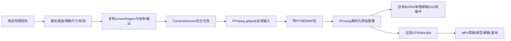

# 手动区域录屏：在原录制窗口中选择来源

2026-11-14。此项属于S07的基础区域视频分支，界面接在已有S06录制窗口。摄像头及其麦克风录制保留；当前区域模式保存无声H.264 MP4，不含麦克风/系统声音、指定窗口跟随或设备热恢复。

## 操作流程

1. 关闭旧MiniClipStudio窗口和VS调试，生成解决方案成功后运行。主窗选择“拍摄 / 区域录屏…”。
2. 来源选“手动区域录屏（无声）”，点击“拖选录屏区域…”。桌面出现半透明覆盖层，用左键拖动；反向拖动也可。Esc或右键取消，取消保留先前选区。
3. 选择结果显示物理坐标及宽高。尺寸向内收成偶数，最小16×16，边长不超过4096且总像素不超过16M；非法区域不隐式变成全屏，可重新拖选。
4. “只预览”可检查区域；停止后再“录制MP4…”，选一个不存在的新文件，设置倒计时/输出fps。区域默认15fps，这是当前CPU处理的起点，不是性能保证。
5. 录制开始后窗口最小化，按 **Ctrl+Shift+F9** 停止并保存。也可恢复窗口点“停止并保存”。热键仅在本次区域录制期间注册；被占用时拒绝开始，避免最小化后没有约定的停止键。
6. 等收尾完成，窗口恢复。用S01查看分辨率/编码，用S05回放检查。若选择了自己的窗口或其他浮动窗口，仍可能录进画面；不是自动移除所有录制UI。

取消选择不启动录制；只预览不写文件。当前没有录制暂停或无缝切换。屏幕分辨率/布局改变后应重新选区，不承诺自动跟随。

## 主要代码

| 文件 | 作用 |
|---|---|
| src/platform/windows/capture/ScreenRegionSelector.h/.cpp | ScreenRegion值、NormalizeScreenRegion纯坐标算法、物理桌面范围、选择覆盖层与取消 |
| apps/desktop/CameraWindow.cpp | 来源选择、区域说明、复制选项、热键、最小化/恢复、停止与真正join |
| src/capture/camera/CameraCapture.h/.cpp | 兼容原入口，screenRegion非空选择gdigrab；复用解码/预览/编码/发布，校验互斥输入与范围 |
| apps/cli/CameraCommands.cpp | screen-record参数、坐标解析、可选交互选区、Ctrl+C停止保存 |
| tests/integration/ScreenCaptureTests.h/.cpp | 纯坐标边界与测试自有色块窗口的真实gdigrab捕获 |
| tests/verify_screen.py | 输出/参数/源像素/重解校验，记录EXE哈希与报告 |

共享引擎暂保留RunCameraCapture名称，使原S06调用保持兼容；区域输入由明确的optional字段分支，不新增空壳类，也不复制整套编码/文件发布。src/capture/screen目录仍无业务cpp，不能因目录占位就误认当前实现位置。

## 数据与时间怎样走



gdigrab通过FFmpeg C API打开，传desktop及video_size、offset_x/y、framerate、draw_mouse等选项，不执行ffmpeg.exe。支持区域/负偏移的后端含义见[FFmpeg官方gdigrab说明](https://ffmpeg.org/ffmpeg-devices.html#gdigrab)。

选择线程与采集线程各自临时切换为每显示器DPI感知，结束恢复原上下文；不修改Windows缩放设置。矩形用物理像素，避免150%缩放下将逻辑坐标错当采集像素。纯算法验证负坐标不等于已在所有混合DPI多屏机器实测。

gdigrab的包可能带Unix微秒大数，不能沿用只够较小图时钟的上界。合法范围校验后仍减本次origin，输出从自己的媒体坐标开始。区域首版只一条视频轨；加入声音需要另外确定音频输入和时钟映射，不是给gdigrab拼上audio=名称。

停止仍是保存已有内容：输入停止→解码/过滤/编码排空→Mp4Output完成草稿→不覆盖发布。文件写错或像素/设备异常仍失败并清理，不因用户按了停止就当成功。

## 启动积压的修正

初次真实测试设置2秒，成片出现4.2秒：通用流信息探测为估帧率预读了约20帧，这些帧随后仍进入录制。屏幕帧率由程序明确设置，因此仅屏幕路径设置fps_probe_size=0，仍保留实际BMP规格探测；探测后再开NONBLOCK，使首帧等待不会以EAGAIN误结束探测，后续读循环可检查停止。

这项修正不等于所有实时源都该跳过探测。摄像头保留原协商/探测逻辑；真实录制时限也仍不是S03精确裁剪契约。验证数据见本次工作记录。

## CLI

```powershell
& '.\AudioCapture\x64\Debug\AudioCapture.exe' --screen-record --select '.\workspace\新区域录屏.mp4' --fps 15
# 已知物理坐标可直接使用；负坐标只适用于确实位于主屏左/上方的屏幕。
& '.\AudioCapture\x64\Debug\AudioCapture.exe' --screen-record 100 100 640 360 '.\workspace\新区域短录.mp4' --seconds 3 --fps 15
```

Ctrl+C表示停止并保存。--mic在区域模式会明确拒绝，不静默丢声音；摄像头模式仍可使用--mic。--select需要图形桌面交互，不是无人值守服务器接口。

## 验证和边界

```powershell
python tests/verify_screen.py --exe '.\AudioCapture\x64\Debug\AudioCapture.exe' --lifecycle '.\build\lifecycle\Debug\LifecycleTests.exe' --with-desktop
```

真实测试创建自己的四色窗口，仅抓其中128×96范围，核真实像素/偏移，再重解成片；不抓用户私人桌面。坐标测试包含反向、负坐标、越界、偶数收缩、小区域及超限。具体Debug/Release证据与GUI工具限制见[本次工作记录](worklogs/2026-11-14-preview-flash-region-recording.md)。

仍需人工检查拖选/Esc、不同缩放/多屏、热键占用、最小化/停止/恢复、真实长录与显示布局变化。GDI/CPU不是游戏高帧率/GPU录屏方案，不承诺受保护视频或所有硬件加速窗口都能正常捕获。

## Ctrl+C与草稿（2026-11-14修复）

窗口录屏时Ctrl+C/Ctrl+Break现走正常关窗：系统回调只设置原子请求，GUI停止会话，后台排空并完成MP4后退出。请等窗口自行关闭。Ctrl+Shift+F9只停止并返回窗口。关闭控制台窗口、停止VS调试、结束进程或断电可能跳过保存；.part是未完成草稿，改后缀不能补索引，本次不实现旧草稿恢复。具体证据见[本次记录](worklogs/2026-11-14-console-stop-recording.md)。
