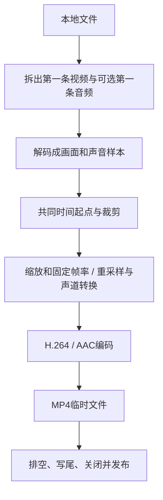

# S03：单素材转码、裁剪与可靠MP4导出

先想弄清这个功能由哪些模块、库和函数配合完成，可以从[功能串讲的S03一节](FEATURES_S01_S04_WALKTHROUGH.md#s03)开始，再回来查本篇的使用和边界。

2026-11-13。基于当前已核实FFmpeg SDK实现，核心全部使用C API，包括libavfilter过滤器图，不调用ffmpeg.exe。当前交付有限范围的CPU转码CLI，不新增GUI按钮、不引入Qt或CMake。

## 先理解这一步

S02取得画面并保存首张PNG；S03把连续画面和可选声音处理后，重新编码并保存为一段MP4。已有`--convert INPUT OUTPUT.wav`继续提供第一音轨到固定WAV的音频转换，沿用原录音链路。本轮新MP4链不冒充与旧WAV完全共用所有实现：它复用资源/错误工具及API协议，音视频统一经新轨道链处理。



## VS与命令行使用

打开根MiniClipStudio.slnx，将AudioCapture设启动项目，选Debug/x64生成。项目属性→配置属性→调试→命令参数填写（路径换成真实文件，输出尚不存在）：

```text
--export "C:\素材\输入.mp4" "C:\素材\输出.mp4" --size 1280 720 --fps 30
```

Ctrl+F5运行；参数分支只出现控制台，不显示录音窗口。清空参数恢复GUI。输出报告与进度出现不等于已经发布，必须看到“导出成功”并正常退出。长素材处理时可在控制台按Ctrl+C发出取消请求；VS的强制停止、关闭控制台或进程被杀不等同于合作式取消，不保证清理。

```powershell
cd C:\Projects\MiniClipStudio
& .\AudioCapture\x64\Debug\AudioCapture.exe --export "C:\素材\输入.mp4" "C:\素材\输出.mp4" --size 1280 720 --fps 30
```

| 参数 | 大白话含义 | 默认/范围 |
|---|---|---|
| --export INPUT OUTPUT.mp4 | 重新编码并导出，不是只改后缀 | 本地文件、至少一条非封面视频 |
| --size W H | 输出像素宽高 | 不指定沿用源尺寸；需同时指定偶数宽高，边长≤8192、≤3200万像素 |
| --fps N | 输出每秒画面数量 | 固定整数帧率30，允许1..120 |
| --no-audio | 不输出声音 | 默认存在音轨时重新编码第一条音轨，不混合全部轨道 |
| --sample-rate N | 音频每声道每秒样本数 | 48000；允许44100/48000 |
| --channels N | 输出声道数 | 2；允许1/2 |
| --start S | 相对共同输入起点的裁剪开始秒数 | 0，有限非负数 |
| --duration S | 保留多长 | 0直到输入结束；起点+时长≤24小时 |
| --threads N | 解码、过滤和编码的共享线程配置 | 1；允许1..32；不是进程总线程数 |

处理成功返回0，处理/参数值失败1，缺少基本命令参数2，观察到合作式取消返回3。Ctrl+C回调只写原子标志，不在回调中等待或释放资源。

### 三个操作例子

无声缩放：

```text
--export "输入.mp4" "无声.mp4" --no-audio --size 640 360 --fps 25
```

从第5秒保留3秒，保留首音轨并转单声道：

```text
--export "输入.mp4" "片段.mp4" --start 5 --duration 3 --channels 1
```

测线程配置，使用不同新文件名：

```text
--export "输入.mp4" "线程2.mp4" --size 640 360 --fps 30 --duration 3 --threads 2
```

## 编码、帧率与时间语义

当前固定输出libx264/H.264、YUV420P、CRF23、medium、zerolatency、无输出B帧；音频原生AAC/FLTP/128kbit/s，MP4封装。它是一个明确可测的预设，不是“最佳画质/商业级”的统一标准；输入B帧仍要正确解码排空。

保留音轨指保留其内容并重新编码AAC，不是码流直通。多音轨只选第一条，字幕/附件/章节不复制；音频独立导出WAV仍使用原--convert。packet copy、任意容器/编码/预设选择不在本轮接口中。

共同起点优先取容器start_time，缺失时取选中流中可用的最早start_time，否则0。源帧必须有严格递增的可用呈现时间戳；未知或倒退明确失败，不靠猜FPS默默修复。两轨都减同一裁剪起点，避免各自减首帧而丢相对偏移。

视频先按源PTS保留裁剪区间内的帧，再转换到指定CFR。源与输出帧率不同时会复制/丢弃画面；fps策略可从输出0点保持首个保留画面，以填补首个画面前的空档。不能保证起点恰在两源帧之间时取到不存在的精确画面；这是画面边界选择+重编码，不是任意时刻包复制。末尾输出包时长按请求终点截短，避免最后一帧时长越界。

音频atrim按时间/样本边界裁剪，重采样、对齐输出零点并用async重采样器处理时间间隙（包括必要的前导静音）。asetnsamples的p=0允许最后一个短帧，统计实际送入AAC的内容样本数。AAC编码有priming/padding，解码出的PCM尾部可能多一个编码块；内容样本数、MP4包/轨道时长、解码尾部padding分别检查，不能混为同一个数字。

已知测试：1.1秒开始保留0.55秒，48kHz内容样本26400，20fps画面11帧，输出包末尾均0.55秒；独立解码验证音频880Hz段。带B帧的NUT样本有0.25秒呈现偏移，8帧输入按首帧保持策略输出9帧CFR、末尾2.25秒，是声明的时间策略，不是凭“帧数相等”判断成功。

## 资源、函数与错误路径

| 文件/类型 | 职责与所有权 |
|---|---|
| src/export/Transcode.h | 普通参数、进度与指标、取消异常、同步ExportMp4接口 |
| src/export/Transcode.cpp | 路径/参数检查，打开输入，选流，确定共同起点，逐包分派，顺序收尾、取消与发布 |
| TranscodeTrack.h/.cpp | 每条轨道独占解码器/过滤器图/编码器/复用帧包；输入AVStream和Mp4Output仅借用 |
| OpenFilters | 首帧真实格式→buffer/abuffer→trim/setpts等→sink；图拥有过滤器上下文 |
| ProcessDecoded / ReceiveDecoded | 检查实际格式与时间戳，循环取得解码帧；输入B帧在Finish排空 |
| ReceiveFiltered / SendEncoded | 取转换结果，换到编码器时间基，记录真实时长，送入编码器 |
| ReceiveEncoded | 取包，恢复尾部时长，换到输出流time_base，检查DTS，交封装器 |
| Finish | 解码器EOF→过滤器EOF→编码器EOF，顺数据方向排空 |
| Mp4Output.h/.cpp | 独占临时文件HANDLE、自定义AVIO、输出容器；Write/Seek供库调用，只返回错误码 |
| WriteHeader / WritePacket | 描述轨道并持续交错写包，明确调用顺序 |
| Finish / Publish | 写尾、flush、关闭；再检查取消，以拒绝覆盖方式移动为目标名 |
| Cleanup | 先断开借用pb，再释放容器/AVIO缓冲/句柄，未发布删除自有临时文件；析构不抛 |
| TranscodeTiming.h | ScopedSeconds作用域计时：异常路径也累计API调用墙钟时间 |
| apps/cli/TranscodeCommands.h/.cpp | 解析参数、系统Ctrl+C回调、显示进度与JSON指标；不持有FFmpeg会话 |
| tests/integration/TranscodeTests.h/.cpp | 生成NUT已知声音/画面/偏移样本，独立解码检查输出、验证预取消与运行中取消 |
| tests/verify_export.py | 轨道/参数/像素亮度/音频频率/裁剪样本/末尾/DTS/失败清理自动验证 |
| tools/benchmark_export.py | 预热、多次运行、相同输入与参数下的线程配置对照，记录环境和全部原始观测 |

ExportMp4先创建输入和输出，再创建借用它们的轨道，反向析构先轨道后会话。Frame/Packet在轨道内复用，不把全视频帧堆在vector。durations映射只保留等待编码包输出的帧时长，不能把分配容量当内容长度。新抽象均有实际用途，不为未来模块填空类。

进度回调在导出线程同步调用；当前CLI无额外导出线程，不直接操作GUI。GUI将来接入必须使用worker并按同步规则读取结果。取消在解码/过滤/编码循环、输入返回后和发布前检查；依赖底层配合，没有强制停止系统调用的硬期限。结束前没观察到的请求可能与提交边界竞速，已发布的完整文件不当作半成品删除。

## 性能指标怎样读

JSON在METRICS_BEGIN/END之间，包含总处理墙钟、进程CPU时间差、各API调用累计墙钟、进程峰值工作集、输出字节与实际帧/样本。CPU可能因多线程而大于墙钟；短任务CPU计数可能因系统粒度为0。工作集不是显存，也不是本任务独占内存。

API总计时到发布点，未覆盖随后局部对象析构；进程级基准另外包含启动与清理。阶段计时覆盖send/receive、过滤器feed/get、mux等调用，不是完整CPU热点采样或所有初始化/I/O的穷尽拆分，不能相加冒充总时间。详见PERFORMANCE_WORKFLOW.md。

## 当前限制与验收

本地普通文件，软件8位SDR YUV420/YUV422/NV12/YUYV/UYVY/RGB/BGR/BGRA/BGR0/灰度，源音频mono/stereo；动态格式、缺失/倒退PTS明确拒绝。原AVI B帧样本末尾缺少可用PTS可被拒绝，不能因为S02能计数就断言S03能可靠重建其时间。新NUT延迟样本用来验证保留PTS的输入。

旋转标签、SAR校正、HDR/广色域和完整色彩管理未实现；指定尺寸直接缩放，不自动保宽高比或加黑边。输出标记BT709有限范围，输入未声明色彩时仍依赖过滤器默认解释，不宣称对全部SDR色彩系统精确转换。没有GPU或无损视频转码承诺。

当前裁剪从头解码直到EOF，不做seek/提前停读，便于先验证完整顺序链路；长文件短片段导出可能慢。这是可测量、后续单独优化的点。临时发布不等于断电事务；用户关闭进程可能遗留part。解码成功不等于完整损坏鉴定。

```powershell
python tests/verify_export.py AudioCapture/x64/Debug/AudioCapture.exe build/lifecycle/Debug/LifecycleTests.exe
python tools/benchmark_export.py AudioCapture/x64/Release/AudioCapture.exe build/lifecycle/Release/LifecycleTests.exe --repeats 3
```

自动测试覆盖已知输入与输出重读；真实素材观看、试听、控制台Ctrl+C、更多设备/格式仍需用户验证。不能用自动报告代替真实观感验收。原录音/探测/S02保持回归，具体证据见本次worklog。

## S06复用带来的增量（2026-11-14）

TranscodeTrack新增默认空的同步视频观察者，S03仍不传它。源8位SDR格式增补NV12、YUYV422/UYVY422、YUV422P/YUVJ422P、BGRA/BGR0，以接摄像头；输出仍为原H.264/YUV420P。尺寸、颜色、PTS、动态格式与错误检查仍保留。S03取消撤销和S06停止保存不同，不能互换控制标志。两配置S03回归均通过。
