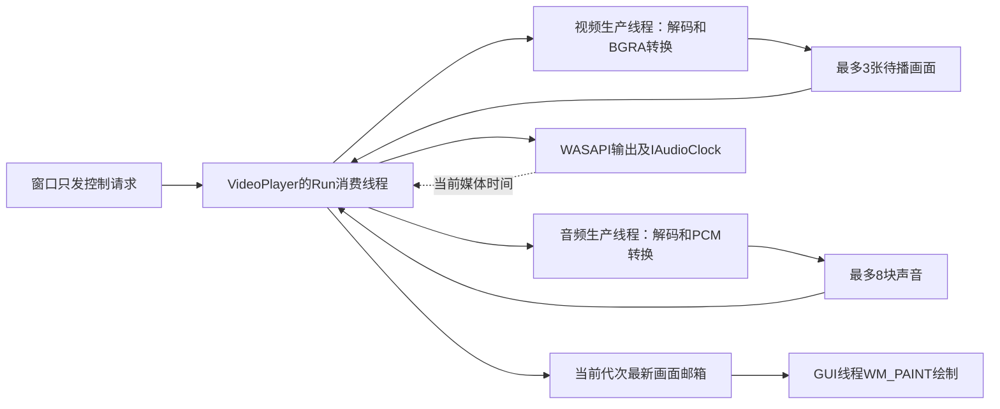

# S05：单视频预览、音画同步和跳转

S06当前入口（2026-11-14）：基础摄像头预览/可选麦克风MP4已实现，见[摄像头说明](CAMERA_CAPTURE.md)。本篇原有功能仍按自己的范围使用；S06复用不表示它新增所有摄像头控制、HDR或设备恢复。当前学习优先读本地六册，历史段落按日期理解。

2026-11-14。S05基础功能使用原VS/Win32工程实现，包含本地单视频显示、首音轨播放、1倍速音画调度、暂停/继续、音量、停止/重播和按秒跳转。验证证据与待人工验收见[工作记录](worklogs/2026-11-14-s05-video-preview.md)。

## 先在VS运行

打开根`MiniClipStudio.slnx`，AudioCapture设为启动项目，选择Debug/x64或Release/x64并生成。清空“项目属性→调试→命令参数”中原来的`--export`等参数，Ctrl+F5打开主窗口，等待设备枚举结束，点击“打开视频…”。

预览在独立窗口打开，主窗口暂时禁用，关闭预览后恢复。预览中可以暂停/继续、选音量、输入秒数后跳转；停止后用“重新播放”从头开始。自然结束后也可重新定位。定位过程中再次提交目标，只处理最新请求。

也可以在VS的命令参数填：

```text
--preview "C:\Projects\MiniClipStudio\1pro.mp4"
```

`--preview`不带文件会打开文件选择对话框。S02首帧导出、S03转码和S04纯音频播放的原入口保留。

## 声音和画面怎样接起来



`VideoPlayer::Start`安排Run打开输入信息、WASAPI和硬件时钟，再创建两路生产线程。视频与音频各自打开同一文件，保管自己的FFmpeg上下文。这样视频队列满时不会堵住音轨读包，暂停/跳转也容易分别清理。代价是重复拆封装和读包，首版先保证有限资源与清楚的所有权，后续测量后再考虑共享拆封装。

### 参与模块和函数

| 文件 | 在S05里完成的步骤 |
|---|---|
| `src/playback/PreviewTypes.h` | 画面、PCM块、共同文件起点和请求代次等普通数据；像素/样本由数据对象拥有 |
| `src/media/ffmpeg/PreviewInput.h/.cpp` | PreviewInput打开本地文件/实际解码器、读包、关键帧seek及flush；ReadPreviewSource选择首条非封面视频/可选首音轨 |
| `src/media/video/VideoPreview.h/.cpp` | DecodePreviewVideo还原源画面、保留PTS/VFR，选覆盖目标的一帧，经swscale转成独立BGRA |
| `src/media/audio/AudioPreview.h/.cpp` | DecodePreviewAudio保留首音轨共同媒体时间，swr统一float48k双声道，按采样点裁掉目标以前部分 |
| `src/playback/VideoPlayer.h/.cpp` | Run消费两队列、按主时钟发布画面，ProduceVideo/ProduceAudio等待有限空位，Seek/Stop协调代次与真实退出 |
| `src/platform/windows/output/WasapiOutput.h/.cpp` | 原S04接口上按需增加EnableClock/ClockSeconds/ResetStopped，S04不必获取新时钟服务 |
| `src/platform/windows/output/VideoSurface.h/.cpp` | DrawPreviewPicture通过StretchDIBits绘制BGRA，保持比例、黑边、上下方向和清屏 |
| `apps/desktop/VideoPreviewWindow.h/.cpp` | 打开独立窗口、按钮/秒数跳转、合并通知与WM_PAINT、关窗后真实回收 |

FFmpeg的libavformat读容器和包，libavcodec解码，libswscale转换像素，libswresample转换声音规格。这里没有转码编码器或输出媒体文件，也没有用FFmpeg命令行代替核心。

## 第一次遇到这些时间名词

PTS标记内容应该呈现的时间，time_base表示一格时间有多少秒。预览用解码后真实的best_effort_timestamp，不按“帧号÷平均帧率”重建，所以20/60ms交替的VFR仍保留原节奏。B帧可能延迟产出，输入EOF后仍要排解码器。

视频和音频都减同一个文件起点，不能分别减自己的第一PTS。声音原本晚0.2秒开始时，AudioPreview仍把块起点标成第9600个48k音频帧，Run先交0.2秒静音，再交内容，这样不会抹掉原相对偏移。

初始duration来自元数据，可能不精确。本轮NUT夹具显示估计4.46秒，但真实选中轨道解码到4秒；因此不通用地“减一次origin”修容器。播放不按这个估计提前截断或一次性补完尾静音；两解码器结束后，以实际源PTS/样本尾更新最终时长。

## 为什么要读取硬件时钟

S04的submitted-padding表示客户端缓冲消费估算。S05向WASAPI取得IAudioClock，用GetPosition/GetFrequency算设备流秒数，再加当前代次的媒体锚点。不能假定position就是48k样本数。

padding为0时，最后一小段声音仍可能在设备管线中。本轮首测就观察到约24ms的差；已修正为还要等硬件时钟覆盖媒体尾部，再结束。视频没有音轨时使用可暂停的steady_clock；音轨先结束时只补静音到已经准备好的视频区间，维持同一主时钟。

声音供给短暂不足时，只有设备时钟也走完已提交内容后，才暂停/Reset并从该内容末尾重新锚定；不会把设备空转的时间算成已经播放的源内容。队列、时钟进度和饥饿次数有观测点，持续没有进展会清楚失败。

## 跳转怎样避免旧声音和旧画面回来

1. `Seek`先增加generation，清队列和当前显示结果。这个编号就是“第几次播放/定位请求”。
2. FFmpeg中断回调、解码后的交付和入队等待都观察编号；旧请求完成也不能发布到新请求。
3. Run先结束在途Write，再在拥有设备的线程执行Stop→Reset，丢掉旧待播PCM并让硬件流时钟归零。
4. 每条生产线程为新请求重新打开输入，从目标以前的关键帧seek并flush解码器，重建转换状态，再前置解码到目标。旧swr延迟直接丢弃，不按EOF排进新位置。
5. 视频选择覆盖目标的画面，例如25fps跳1.10秒，首图是1.08—1.12秒这一张；音频裁到向上取整后的目标采样点。定位准备好才确认acknowledgedGeneration。
6. 暂停seek显示新目标一帧，仍保持暂停。快速连续seek只确认最后一代。自然结束回收后可重新打开同一文件定位。

`avformat_seek_file`的BACKWARD标志在本机SDK中明确无效，因此实现使用选中轨道单位的`av_seek_frame(..., AVSEEK_FLAG_BACKWARD)`，并向下换算目标时间；seek成功本身不等于已取得目标画面，前置解码不可省。

视频先结束时保持末图到声音结束。跳到纯音频尾段也会重新解出本代末图，不借用上一次请求的旧图；finalFrame标记区分这种有意保持与迟到。

## 窗口怎样收到画面

工作线程只替换一个最新画面邮箱并PostMessage通知，不把AVFrame裸指针塞进窗口消息。通知合并，GUI在WM_PAINT取走当前代次的shared_ptr<const PreviewPicture>，绘制前再次核对generation。vector拥有像素，直到本次绘制完成都有效。

BGRA每像素4字节，DIB高度为负表示自上向下。DrawPreviewPicture核对尺寸/缓冲并等比缩放，剩余区域画黑。绘制与FFmpeg/WASAPI分属不同线程，GUI不直接seek解码器或释放设备。

关闭预览先Stop并继续处理消息，TryJoin确认后台真正退出后才DestroyWindow；异常/析构仍真实Shutdown，不detach、不超时假退出。原AudioPlayer和RecordingController没有被搬成新通用框架。

## 怎样判断同步和功能是否正确

`maxScheduleLatenessUs`测发布邮箱时是否已经越过该帧有效区间；GUI成功绘图后另记`maxPaintLatenessUs`，两者不混称。测试还独立轮询画面和时钟记录邮箱迟到。刻意保持末图不当作迟到。这些是程序时钟/调度观测，不是测到扬声器与物理屏幕的端到端延迟。

```powershell
python -X utf8 tests/verify_preview.py --exe AudioCapture/x64/Debug/AudioCapture.exe --lifecycle build/lifecycle/Debug/LifecycleTests.exe --with-device
```

脚本使用多GOP/B帧、VFR、声音晚开始、声音先结束、无声等已知素材，检查实际PTS/灰度/PCM频率、跨非关键帧seek、暂停/快速seek、EOF后seek、完整尾部与队列容量。GDI测试读CreateDIBSection的真实像素；设备分支实际使用WASAPI并静音，未传--with-device只能证明数值/GDI部分。

实际报告及构建状态以工作记录为准。窗口自动化本轮仍因内核资源路径错误不能启动；可见窗口交互、缩放/遮挡恢复、真实素材听感与长时/断连仍需用户验收，不能用离屏像素检查代替。

## 首版范围与下一步

当前固定1倍速，本地首视频/首音轨，固定mono/stereo、8—192kHz、可用连续音频时间戳和有限8位SDR视频格式。动态格式、时间大洞/重叠、无可靠视频PTS、HDR/宽色域等明确拒绝。最大4096边、16M像素，队列有界不等于进程只占队列样本大小。

按编码宽高显示，未做旋转矩阵/SAR校正；尚无网络、字幕、输出设备切换/自动重连、硬件解码或倍速/保调音频。倍速按路线留作独立小步，不把当前基础预览说成完整商业播放器。先验收正常素材、暂停/seek/关窗和听感，再做下一轮兼容与测量。

三题：为什么两轨共用时间原点？为什么清解码器还不够完成seek？为什么padding为0仍不代表硬件已经播放完？

## 固定频率闪白修正（2026-11-14）

用户反馈可正常播放但反复闪白。根因是WM_PAINT先FillRect全客户区浅色，再清黑/画视频；仅抑制WM_ERASE无效。改用BufferedVideoSurface先在内存画完再BitBlt，ClearAroundPreview只擦外围；仅视频区可见的重绘才取图/ReportPainted，减少无关重绘。原时钟/seek保留，未声称GPU加速或所有负载流畅。像素/错误保留及播放回归通过，实际观感仍请用新EXE验收；[根因和验证](worklogs/2026-11-14-preview-flash-region-recording.md)。
